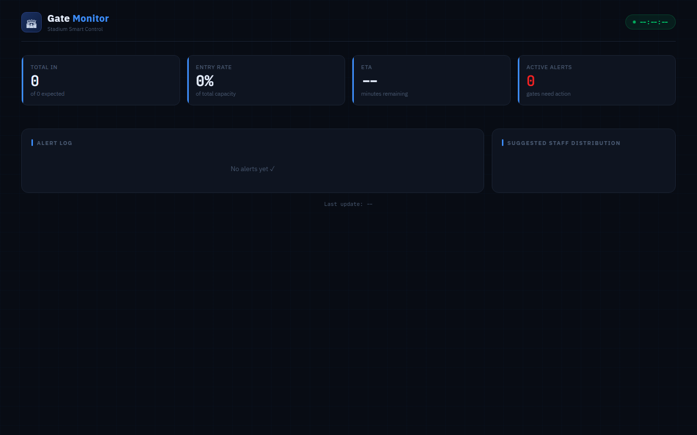

<a href="https://github.com/Abdulel3h">
  <picture>
    <source media="(max-width: 600px)" srcset="assets/terminal-mobile.svg">
    
  </picture>
</a>

**A computer-vision prototype that counts people at four stadium gates and turns the counts into a status a control room could act on.**

Prototype. It runs on local video files or a webcam with hard-coded gate zones. It has not been calibrated against a real venue, and no accuracy is claimed.

###### HOW IT WORKS

1. **Detect.** YOLO finds people in each frame of a video file or webcam.
2. **Place.** Each detection's centre is mapped to one of four configured gate zones.
3. **Decide.** `DecisionEngine` sets each gate's status from occupancy: normal below 50%, busy below 75%, critical below 80%, overflow from 80%. It logs crowding and overflow alerts, suggests a redirect to the lightest gate and recommends where staff should go.
4. **Serve.** Flask exposes the state at `/api/status`, and `dashboard.html` polls it every two seconds.

###### EVIDENCE

- The hero shows a sample state worked through the same thresholds and alert text as `stadium_system.py`: gate C at 85% is overflow, and the lightest gate is A.
- Implemented and readable in `stadium_system.py`: person detection across four zones, four status states, an alert log, staff distribution, and Flask status and health endpoints.

**Not claimed:** any measured accuracy. Zones are hard-coded per camera angle, no automated tests cover counting or thresholds, local model and video files make the repository large, and a real installation would need privacy, latency and operations review. [All limitations](docs/overview.md#limitations)

<details>
<summary>Screenshot</summary>



Captured from the committed dashboard HTML.
</details>

###### QUICK START

```bash
python -m venv .venv
. .venv/Scripts/activate           # macOS/Linux: . .venv/bin/activate
pip install ultralytics opencv-python flask flask-cors numpy
python stadium_system.py
```

The API starts at `http://localhost:5000/api/status` and an OpenCV window shows the processed video. Set `VIDEO_SOURCE` in `stadium_system.py` to a scenario file or `0` for a webcam, open `dashboard.html` while the API runs, and press `q` to quit.

###### DOCUMENTATION

[Overview](docs/overview.md) · [Architecture](docs/architecture.md) · [Case study](docs/case-study.md) · [Engineering principles](docs/engineering-principles.md) · [Technical decisions](docs/technical-decisions.md) · [Reviewer guide](docs/reviewer-guide.md) · [Arabic notes](شرح.md)

<sub>[Abdulelah Alkhathami](https://github.com/Abdulel3h) · [abdulelah.de](https://www.abdulelah.de) · No license file yet, so all rights are reserved by default.</sub>
